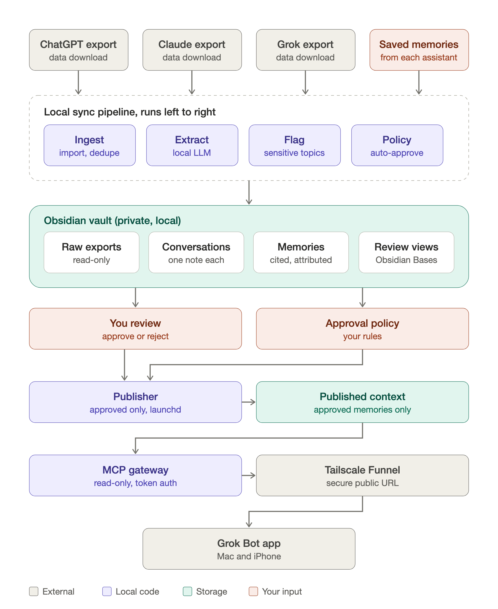

# Personal AI Memory

A local-first memory layer for your AI assistants. It turns your ChatGPT, Claude and Grok
exports into a private Obsidian vault, extracts memories with a local model, lets you (and rules
you write) decide which memories are shareable, and serves only those to an assistant over MCP.



Principles:

- **Private by default.** Every note starts `access: private`. Raw conversations are never published.
- **Approval binds to content.** An approved memory that you edit later is held until you approve it again.
- **Local models only.** Extraction and classification run in LM Studio on your machine; requests go only to `127.0.0.1`.
- **Every memory is cited and attributed.** Each one carries a verbatim quote, the message it came from, and who said it (you, or an AI suggestion).
- **Everything is logged.** Approvals, publishes and gateway requests go to append-only audit logs in `state/`.
- **Python standard library only.** No packages to install.

## Requirements

- macOS (launchd is used for the background services; the scripts themselves are portable)
- Python 3 (tested on 3.14)
- [Obsidian](https://obsidian.md) (Bases are used for the review views)
- [LM Studio](https://lmstudio.ai) with:
  - an extraction model (default `qwen/qwen3.8-27b`; any instruction model that returns JSON will do, pass `--model`)
  - `text-embedding-nomic-embed-text-v1.5` for project suggestions
- Optional, to reach the gateway from a phone or a cloud assistant: [Tailscale](https://tailscale.com) with Funnel

## Setup

```bash
git clone <this repo> && cd personal-ai-memory
cp approval_policy.example.json approval_policy.json   # then edit it for your projects
```

The vault defaults to `~/personal_chats` and the published folder to `~/GrokBotContext`.
Every script takes `--vault` if you keep it elsewhere.

## First sync

1. Request data exports: ChatGPT (Settings > Data controls > Export), Claude (Settings > Privacy >
   Export data) and Grok (Settings > Data controls). Save the zips to `~/Downloads`.
2. ChatGPT saved memories and custom instructions are not in its export. After the first run, paste
   them into `04-Profile/ChatGPT saved memories.md` and `04-Profile/ChatGPT custom instructions.md`.
3. Run the whole pipeline:
   ```bash
   python3 sync.py --dry-run   # shows which exports it found
   python3 sync.py             # import, extract, flag, apply policy, publish, report
   ```
   `sync.py` starts the LM Studio server and model if needed and stops them afterwards.
   Extraction takes a few minutes per conversation chunk on a laptop.
4. Open the vault in Obsidian and check `05-Reports/Sync Status.md`.

## Reviewing memories

Memories your rules do not cover land in review (`policy_outcome: review`). Build an Obsidian Base
view on `03-Memories` with this filter and edit `access` in place:

```yaml
filters:
  and:
    - type == "memory"
    - access == "private"
    - policy_outcome == "review"
```

- `access: approved` publishes the memory.
- `access: rejected` keeps it private permanently; the policy never touches it again.
- Leaving it `private` keeps it in review, and a later rule could approve it.

When you find yourself approving the same kind of memory repeatedly, add a rule to
`approval_policy.json` instead, bump `version`, and preview with `python3 policy.py run`.

## Approval policy

See `approval_policy.example.json`. In brief:

- Outcomes are `approve`, `private` and `review`. Private beats review, review beats approve.
- Rules match on `projects`, `categories`, `flags`, `subjects` and `attributions`.
- `project_aliases` folds variant project names into one.
- Flags in `never_auto_approve_flags` always block auto-approval. Other flags block it unless the rule lists them in `allow_flags`.
- Only attributions in `auto_approve_attribution` are auto-approved. Memories from a provider's saved memory (`provider_memory`) always need you.
- Memories with no project inherit their conversation's project.
- Manual approvals, `access: rejected`, and approvals you revoked yourself are never changed.

## Publishing and the MCP gateway

`publish.py` copies approved memories (and nothing else) to `~/GrokBotContext`. `mcp_gateway.py`
serves that folder read-only over MCP (Streamable HTTP) with three tools: `search_memory`,
`get_memory` and `get_project_context`. It never reads the vault.

Run both in the background with launchd:

```bash
for f in launchd/*.plist.template; do
  sed -e "s#__REPO__#$PWD#g" -e "s#__PYTHON__#$(command -v python3)#g" "$f" > ~/Library/LaunchAgents/$(basename "$f" .template)
done
launchctl load ~/Library/LaunchAgents/com.personalmemory.publish.plist ~/Library/LaunchAgents/com.personalmemory.mcp.plist
```

The gateway listens on `127.0.0.1:8765` only. Create one token per client; it is printed once:

```bash
python3 mcp_gateway.py token create my-assistant
python3 mcp_gateway.py token list
python3 mcp_gateway.py token revoke my-assistant
```

To reach it from outside your machine, expose it over HTTPS, for example with Tailscale Funnel:

```bash
tailscale funnel --bg 8765
```

Then add a custom MCP connector in your assistant with the URL `https://<your-funnel-host>/mcp`
and the token. `try_grok.py` tests the round trip through the xAI API:

```bash
MEMORY_GATEWAY_URL=https://<your-funnel-host> XAI_API_KEY=... python3 try_grok.py "What do you know about my projects?"
```

## Scripts

| Script | What it does |
|---|---|
| `sync.py` | Finds the newest exports in Downloads and runs everything below in order. |
| `ingest.py` | Imports exports into `02-Conversations`; archives raw files read-only in `01-Raw-Exports`. Never overwrites notes you edited. |
| `import_profile.py` | Turns Claude saved memories and the ChatGPT paste-in notes into memory notes. |
| `extract.py` | Local model extracts cited, attributed memories into `03-Memories`. Only new or changed conversations. |
| `flag.py` | Adds keyword sensitivity flags from `flag_rules.json`. Never re-adds a flag you removed. |
| `suggest_projects.py` | Suggests projects for unlabeled conversations from your hand labels (embeddings). |
| `classify_projects.py` | LLM project classification; keeps suggestions where it agrees with the embeddings. |
| `policy.py` | `projects` lists project names; `run` previews; `run --apply` applies the policy. |
| `publish.py` | `sync` once, or `watch` continuously. |
| `mcp_gateway.py` | `serve` the gateway; `token create/list/revoke`. |
| `status.py` | Writes `05-Reports/Sync Status.md`: freshness, gaps, pending work. |

Tests: `python3 -m unittest discover -p "test_*.py"`.

## What stays on your machine

`state/` (manifests, audit logs, tokens, embeddings) and `backups/` hold personal data and are
git-ignored, as is your `approval_policy.json`. Never commit them.

## Known gap

Assistants whose conversations have no export (some desktop and mobile apps) can read from the
gateway but their conversations do not flow back into the vault.
